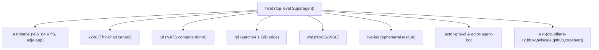

# Skidbladnir

**Personal Situated NixOS Fleet (`ADR-0017` Layer L3) — Composing `baugr` -> `verft` -> `ivaldi` in One Barrier-Free Fractal Namespace.**

> [`baugr`](https://github.com/LW-54/baugr) (L0 math) -> [`verft`](https://github.com/LW-54/verft) (L1 Nix/Linux engine) -> [`ivaldi`](https://github.com/LW-54/ivaldi) (L2 reusable library) -> **`skidbladnir` (L3 personal fleet)**



## Fleet Inventory

| Host / Scope | System | Role & Key Composition |
| :--- | :--- | :--- |
| **`astrolabe`** | `x86_64-linux` | Impermanent production VPS (`adje.app`, `11264 MiB`), `base-server` + `hw-astrolabe` + `caddy-{public,mesh}`, `vaultwarden`, `auth-stack`, `notify-ntfy`, `cache-niks3`, `compute-nats-hub`, `sync-git-annex`, `obs-hub`, `docs-mdbook`. |
| **`x240`** | `x86_64-linux` | Roaming LUKS2+TPM2-PIN ThinkPad canary (`16384 MiB`), `base-workstation` + `hw-x240` + `backup-restic` + `cache-harmonia-dev`. |
| **`tuf`** | `x86_64-linux` | AC lid-closed opportunistic compute-donor laptop (`16384 MiB`), `base-workstation` + `compute-nats-worker` (worker-only NATS RBAC). |
| **`rpi`** | `aarch64-linux` | Constrained `1024 MiB` ARM edge host (`target-nixos-rpi`, `fs-simple-disk`, `verft-pull`, `obs-fluent-node`). |
| **`wsl`** | `x86_64-linux` | Diskless NixOS-WSL workstation (`4096 MiB`). |
| **`live-iso`** | `x86_64-linux` | Ephemeral rescue & onboarding USB ISO (`2048 MiB`, **0** prod secrets, **0** mesh access). |

## Daily Operations

```bash
# Enter full fleet devShell (verft + baugr + baugr-doc + ivaldi emitters + mdbook)
nix develop

# Run full F3 verification suite (strict ERG-L2, 514-case Lean DRT, 12 attacks, S1 equiv, emitter audits, mdBook, KVM VM)
nix flake check -L

# Open an ephemeral CLONE_NEWNS RAM-tmpfs capability session
verft cap run --cap-dir ./capabilities --posture online sops-root github-cli -- bash

# Build out-of-Git mdBook architecture + 3 AM runbooks site
nix build .#docs-site
```

## Formal Verification Pillar (`F3`)

`nix flake check -L` executes **7 hermetic gates**:

1. `fleet-check-and-drt` — strict `ERG-L2` verification (`14/14` superagents), **`514/514` Rust <-> Lean 4 DRT** (`0` divergences), SST impact cone, and all 6 Cedar policy projections.
2. `adversarial-12-attacks` — automated regression suite mutating real fleet manifests and proving **all 12/12 attacks** (secret leaks, AI escalation, online/offline mixing, dev cache on prod, mesh leak, dual-zone smuggling, CALM violation, `rpi` RAM overcommit, NATS escalation, bot escalation, atomic CI leak, unexported interior offer) are statically blocked.
3. `s1-erg-l2-equiv` — **0-byte diff** between Rust `baugr` and Pure-Nix `verft.lib.realize` across all **65 agents** and **12 closed superagents** + realization of all **6 NixOS hosts** (`x86_64-linux` + `aarch64-linux`).
4. `policy-emitters-audit` — 0-byte drift verification on `.sops.yaml`, `policy/tailscale.json`, and `policy/nats-rbac.json` + positive & negative `verft-cap` posture/conflict checks.
5. `docs-site` — builds the full static `mdBook` site from `baugr --json graph | baugr-doc` + `docs/runbooks/`.
6. `nix-fmt` — `alejandra --check`.
7. `vm-astrolabe-smoke` — live KVM QEMU boot of situated `astrolabe` (`adje.app` offline TLS, `/etc/verft/*.json` wiring, and `systemctl stop tailscaled.service` survival).
